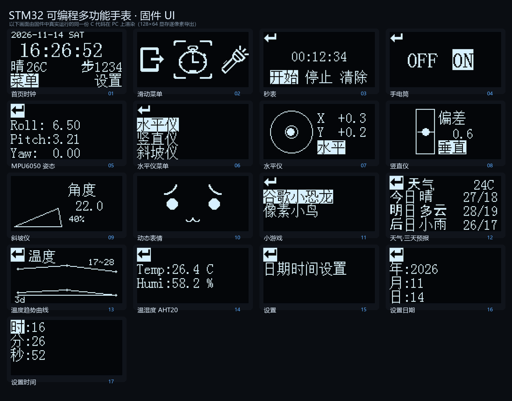
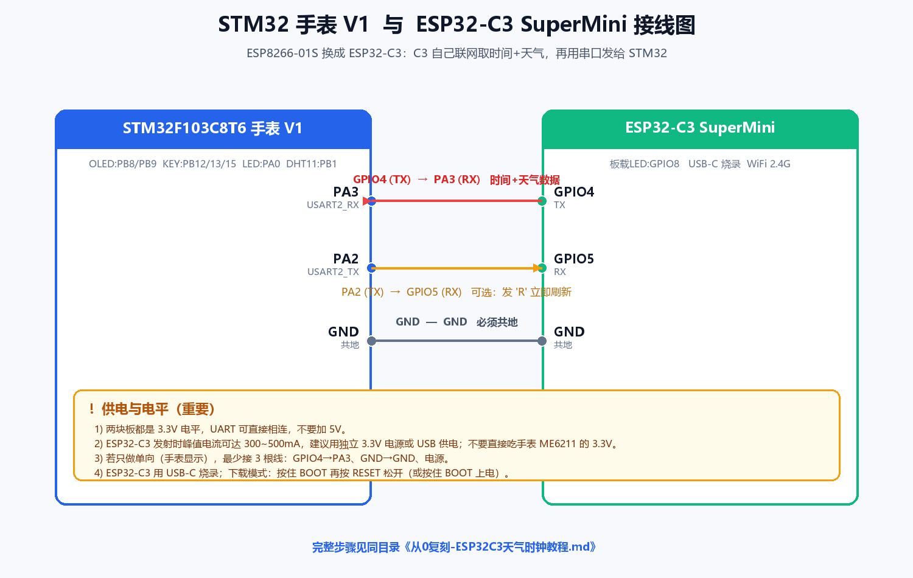

<div align="center">

# ⌚ STM32 可编程多功能手表 · v2.0

**在 v1 的基础上加了一颗 ESP32-C3：真实天气、网络校时、手机网页控制，还更省电。** 🌤️

[](https://www.st.com/)


📽️ [实机演示](#demo) · 🆕 [v2 更新](#changelog) · 🔧 [硬件接线](#hardware) · 🔌 [串口协议](#protocol) · 📱 [Web 控制](#portal) · 🚀 [编译烧录](#quickstart)

</div>

## 🧭 项目简介

这是一块基于 **STM32F103C8T6** 的可编程多功能手表。v1 里它已经能走时、滑动菜单、量姿态、玩游戏；到了 **v2**，又配上一颗 **ESP32-C3 SuperMini**：由 C3 负责连 WiFi、走 NTP 取网络时间、拉真实天气，再通过一条 UART 把数据喂给 STM32 显示。

于是手表首页有了**真实时间 + 当前天气 + 步数**，天气页能看到**今日 / 明日 / 后日 三天预报**，还能滑到**多天温度趋势曲线**。串口链路做了 **CRC16 校验 + 序号应答 + 超时重传**，抗干扰、断线也能保住上次数据；同一 WiFi 下用手机浏览器打开 C3 的 IP，就能**改城市 / 心知 key、看实时状态、点虚拟按键远程操作手表，甚至 OTA 升级**。

STM32 侧跑在**裸机 + 标准外设库（SPL）**上，C3 侧是 Arduino 固件，分工清楚；各 UI 页面还支持**无操作自动息屏 + 进 STOP 低功耗**，按键 / RTC 唤醒，更省电。


<a id="features"></a>
## ✨ 功能一览

| | 功能 | 说明 |
|---|---|---|
| 🕐 | **首页时钟** | 日期 + 星期 + 大字时间，实时显示天气 / 温度 / 步数 |
| 🌤️ | **真实天气** | 心知天气实况 + **三天预报**；天气页含**列表页 + 温度趋势曲线页**（KEY1/KEY2 滑动切换） |
| 📶 | **网络校时** | ESP32-C3 走 NTP，每隔约 10 分钟自动校准 RTC |
| 🚶 | **计步** | MPU6050 加速度模值峰谷检测，步数显示在首页 |
| 🎞️ | **滑动菜单** | 32×32 图标横向滑动切换 |
| ⏱️ | **秒表** | 开始 / 停止 / 清除，毫秒级 |
| 🔦 | **手电筒** | 一键点亮板载 LED |
| 📐 | **MPU6050 姿态** | 实时 Roll / Pitch / Yaw 欧拉角 |
| 🧭 | **水平仪** | 水平 / 竖直 / 斜坡三种模式 |
| 😀 | **动态表情** | 表情动画循环播放 |
| 🦖 | **小游戏** | 谷歌小恐龙 + 像素小鸟 |
| 🌡️ | **温湿度** | AHT20（I²C，±0.3℃ / ±2%RH，v2 起替换 DHT11） |

<a id="changelog"></a>
## 🆕 v2 更新记录

- 🔗 **新增 ESP32-C3 联网**：WiFi + NTP 校时 + 心知天气（实况 + 三天预报），通过 UART 文本协议 `$OK / $FC / $FD` 发给 STM32。
- 🛡️ **串口协议加 CRC16**：每帧 `$...*<CRC16>`（CRC-16/CCITT-FALSE），STM32 校验失败直接丢帧，抗干扰/防错位。
- 🔁 **可靠传输**：序号 `seq` + `$AK` 应答 + 200ms 超时重传(最多3次) + STM32 去重；解决首帧丢失与瞬断，断网时保留上次数据。
- 📱 **局域网 Web 配置 + OTA + 手机虚拟按键**：WiFi 在固件顶部写死直连；同一 WiFi 下浏览器打开 C3 的 IP 即可改城市/key、点按钮远程操作手表菜单；支持 ArduinoOTA。
- 📈 **天气页第二页**：新增**多天温度趋势曲线**（高/低温折线），KEY1/KEY2 左右滑动切换；数据来自 `$FD` 多天预报（心知免费版 3 天，付费最多 15 天，代码自动适配）。
- 🧱 **新增分层驱动**：`Serial.c/h`、`esp32c3.c/h`、`weather.c/h`。
- 🏠 **首页升级**：显示真实时间、当前天气/温度、步数。
- 🌡️ **AHT20 替换 DHT11**：精度更高，移除 DHT11 驱动与页面。
- 🚶 **新增计步**：`pedometer.c/h`，MPU6050 加速度峰谷检测。
- 💤 **低功耗**：**各 UI 页面** 15s 无操作 → **OLED 息屏 + STM32 进 STOP**，按键(EXTI)/RTC 闹钟唤醒（秒表运行/游戏页除外）；`lowpower.c/h`，可测待机电流。调试时可 `#define LOWPOWER_ENABLE 0`（或 `LowPower_SetEnabled(0)`）关闭。
- 🔤 **字库补充**：天气/预报所需汉字（晴/雨/雷/霾/今/明/后/步…）。

<a id="demo"></a>
## 📽️ 实机演示

> 🖥️ **这张总览，是把固件里「真实运行的同一份 C 代码」搬到 PC 上逐像素渲染出来的**（读取 128×64 OLED 显存导出，非手绘 / PS），与硬件屏幕几乎一致。

<p align="center"></p>

<p align="center">👉 <a href="demo/ui/showcase.md"><b>查看全部界面大图（详细页面）</b></a>　·　生成脚本见 <a href="tools/ui_render/">tools/ui_render/</a></p>

<a id="arch"></a>
## 🏗️ 系统架构

```text
        ┌───────────────────────┐        WiFi         ┌────────────────┐
        │  ESP32-C3 SuperMini   │──────────────────▶  │ 路由器 / 互联网 │
        │  Arduino 固件         │  NTP / 心知天气      └────────────────┘
        └──────────┬────────────┘
                   │ UART 115200（GPIO4→PA3，GND 共地）
                   ▼
        ┌───────────────────────┐
        │  STM32F103C8T6 手表   │  OLED 显示 / RTC 走时 / 按键 / 传感器
        └───────────────────────┘
```

- **ESP32-C3**：连 WiFi → NTP 取时 → 请求心知天气（实况 `now.json` + 三天 `daily.json`）→ 解析 JSON → 串口输出几行文本。
- **STM32**：串口接收解析 → 写 RTC → OLED 显示 → 按键与各传感器页面。

<a id="hardware"></a>
## 🔧 硬件与接线

### STM32F103C8T6 引脚

| 外设 | 引脚 |
|---|---|
| OLED（软件 I²C，SSD1306） | SCL=`PB8`，SDA=`PB9` |
| MPU6050（软件 I²C） | SCL=`PB10`，SDA=`PB11` |
| 按键 ×3 | `PB12` / `PB13` / `PB15` |
| 照明 LED | `PA0` |
| AHT20（软件 I²C） | SCL=`PA11`，SDA=`PA12` |
| **ESP32-C3 串口 USART2** | **`PA2`=TX，`PA3`=RX** |

### ESP32-C3 ↔ STM32 接线

| ESP32-C3 | 方向 | STM32 | 说明 |
|---|---|---|---|
| **GPIO4 (TX)** | → | **PA3 (USART2_RX)** | C3 把时间/天气发给 STM32（**必接**） |
| GPIO3 (RX) | ← | PA2 (USART2_TX) | 可选：STM32 发 `R` 让 C3 立即刷新 |
| GND | — | GND | **必须共地** |
| 电源 | — | — | 建议给 C3 独立 3.3V/USB 供电（C3 峰值电流大） |

> 🔎 C3 的 RX 引脚以 `esp32c3_firmware/ESP32C3_WeatherClock/ESP32C3_WeatherClock.ino` 里的 `STM32_RX_PIN` 定义为准（教程图中为 GPIO5）。最少只需接 **GPIO4→PA3、GND、电源** 三根即可显示。
> ⚡ 注意：手表上的 ME6211C33 带不动 C3 的 WiFi 峰值电流，**不要用表内稳压给 C3 供电**，否则会死机/复位。



<a id="protocol"></a>
## 🔌 串口协议

一行一帧，`\r\n` 结尾，波特率 **115200**。每帧格式：

```
$<类型>,<seq>,<数据...>*<CRC16>\r\n     // CRC16 为 4 位十六进制（大写）
```

| 报文 | 例子 | 含义 |
|---|---|---|
| `$OK,<seq>,<utc秒>,<天气码>,<温度>*<CRC16>` | `$OK,0,1794577140,13,20*B33D` | 时间 + 当前天气 |
| `$FC,<seq>,<今c>,<今高>,<今低>,<明c>,<明高>,<明低>,<后c>,<后高>,<后低>*<CRC16>` | `$FC,1,9,27,18,0,28,18,13,28,19*35E6` | 三天预报（列表页） |
| `$FD,<seq>,<n>,<c0>,<h0>,<l0>,...*<CRC16>` | `$FD,2,3,10,26,19,0,28,19,4,26,21*D0C5` | n 天预报（温度趋势页，n≤15） |
| `$ERR,<seq>*<CRC16>` | `$ERR,3*D2A3` | 取数失败 |
| `$KEY,<seq>,<code>*<CRC16>` | `$KEY,4,2*7324` | 手机虚拟按键（1=上 2=下 3=确认） |
| `$AK,<seq>*<CRC16>` | `$AK,0*1012` | STM32 → C3：确认收到该 seq |

- **CRC 校验**：**CRC-16/CCITT-FALSE**（poly `0x1021`、init `0xFFFF`、不反转/不异或），范围是从 `$` 到 `*` 之前；不一致直接丢帧。
- **可靠传输**：`seq` 序号 + `$AK` 应答 + **200ms 超时 / 最多 3 次重传**；STM32 对"同 seq"帧去重（只补 ACK，不重复应用）→ 解决首帧丢失与瞬断。
- **断网容错**：取数失败发 `$ERR`，STM32 **保留上一次有效数据**，RTC 本地继续走。
- `utc` 为 UTC 秒，STM32 写入 RTC，显示时 +8 小时（北京时间）。
- 一帧可含多行（`$OK\r\n$FC\r\n$FD`），STM32 按行拆分、逐行校验解析。

> 完整协议（时序、CRC 原理、示例帧、参数）见 [docs/串口协议说明.md](docs/串口协议说明.md)。

<a id="portal"></a>
## 📱 局域网 Web 配置 / 控制 / OTA

- **WiFi 直连**：在 `esp32c3_firmware/ESP32C3_WeatherClock/ESP32C3_WeatherClock.ino` 顶部改 `WIFI_SSID / WIFI_PASSWORD`，上电直接连（失败每 5s 自动重连），**不使用 SoftAP 热点配网**。
- **手机/电脑与 C3 在同一 WiFi**，浏览器打开 `http://<C3的IP>`（串口会打印 `Web / OTA: http://...`）：
  - **实时状态 `/status`**：页面顶部每 2 秒自动刷新 IP / 信号 RSSI / 运行时间 / 城市 / 天气码+温度 / 距上次成功 / 成功·失败次数；
  - **城市 / 心知 key** 表单 → 保存即生效（存 NVS，断电不丢）；
  - **▲ 上 / ● 确认 / ▼ 下** 虚拟按键 → 通过串口 `$KEY` 帧远程操作手表菜单。
- **OTA 升级**：ArduinoOTA 主机名 `stm32-watch`，用 Arduino IDE / PlatformIO 的“网络端口”在线烧录 C3。

<a id="structure"></a>
## 📁 目录结构

```text
.
├─ Hardware/            STM32 外设驱动与页面
│  ├─ OLED.c/h          SSD1306 显示驱动（含字库 OLED_Data.c）
│  ├─ MyI2C.c/h         软件 I²C（MPU6050 用）
│  ├─ MPU6050.c/h       六轴姿态
│  ├─ aht20.c/h         AHT20 温湿度（软件 I²C，PA11/PA12）
│  ├─ Serial.c/h        USART1/2 驱动（中断接收）
│  ├─ esp32c3.c/h       ESP32-C3 串口协议解析（$OK/$FC/$FD）
│  ├─ weather.c/h       天气页（列表 + 温度趋势曲线，按键翻页）
│  ├─ pedometer.c/h     计步（MPU6050 加速度峰谷检测）
│  ├─ menu.c/h          首页时钟 + 滑动菜单
│  ├─ menu_sub.c/h      秒表 / 手电 / 姿态 / 水平仪 / 表情 / 游戏 / AHT20
│  └─ dino.c / bird.c   两款小游戏
├─ System/              Delay / MyRTC / Timer
├─ User/                main.c、中断与外设初始化
├─ Start/ Library/      CMSIS 启动文件 + 标准外设库（SPL）
├─ .eide/               EIDE 工程配置（推荐构建方式）
├─ esp32c3_firmware/    ESP32-C3 Arduino 固件（ESP32C3_WeatherClock.ino）
├─ docs/                接线图 + 从 0 复刻教程
├─ tools/ui_render/     在 PC 上编译固件 UI 代码并导出界面 PNG 的脚本
└─ demo/                实机演示素材（demo/ui/ 为固件渲染的界面图，可再放实拍视频）
```

<a id="quickstart"></a>
## 🚀 编译与烧录

### STM32（推荐 VS Code + EIDE）

1. 安装 VS Code + **EIDE** 插件、ARM 编译器（AC5 或 AC6）。
2. 打开仓库根目录，EIDE 会自动读取 `.eide/eide.yml`。
3. 若提示缺芯片包，安装 **Keil.STM32F1xx_DFP 2.4.0**。
4. Build → 用 **ST-Link**（SWD）烧录。

> 也可以用 Keil 新建工程，把 `Start / Library / System / Hardware / User` 里的源文件加入即可（本仓库不附带 v2 的 `.uvprojx`）。

### ESP32-C3（Arduino IDE）

1. 开发板管理器安装 **esp32** 包，建议核心版本 **2.0.17**（新版在 C3 上有连接兼容问题）。
2. 开发板选 **ESP32C3 Dev Module**，`USB CDC On Boot = Enabled`。
3. 打开 `esp32c3_firmware/ESP32C3_WeatherClock/ESP32C3_WeatherClock.ino`，修改顶部配置：
   ```cpp
   WIFI_SSID / WIFI_PASSWORD   // 你的 2.4G WiFi
   CITY                        // 城市拼音，如 guangzhou
   SENIVERSE_KEY               // 心知天气私钥（自己免费申请）
   ```
4. 上传，串口监视器 115200，应看到 `发送 -> utc=... code=... temp=...` 与 `预报 -> ...`。

<a id="faq"></a>
## ❓ 常见问题

- **C3 连不上 WiFi / `reason=2 AUTH_EXPIRE`**：把 esp32 核心降到 **2.0.17**，保持 `WiFi.setTxPower(WIFI_POWER_8_5dBm)`；热点用 **WPA2-PSK / 2.4GHz**，别用 WPA3。
- **STM32 显示 No data（C3 已发出）**：C3 先上电、STM32 后上电会错过首帧。接上 `PA2→C3 RX` 让 STM32 上电自动请求刷新，或按一下 C3 复位。固件已内置开机 3 分钟内每 20 秒重发。
- **OLED 某个汉字显示 "?"**：该字不在字库 `OLED_Data.c` 的 `OLED_CF16x16` 中，需补字模。
- **AHT20 报 `Code:-1`**：寻址失败，检查 SCL/SDA 是否接反、VCC 是否 3.3V、上拉是否正常。


