# 🖼️ 全部界面大图

> 以下界面均由**固件里真实运行的同一份 C 代码**在 PC 上逐像素渲染导出（128×64 OLED 显存 → PNG），非手绘 / PS，与硬件屏幕几乎一致。

[← 返回 README](../../README.md)　·　生成脚本见 [tools/ui_render/](../../tools/ui_render/)　·　总览图 [00_overview.png](00_overview.png)

---

| | | | |
|:--:|:--:|:--:|:--:|
| 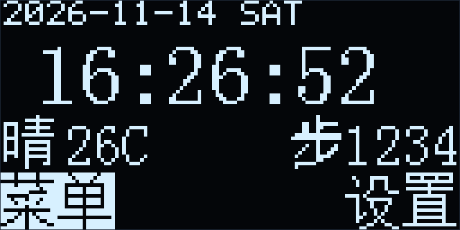 **首页时钟** 时间 · 天气 · 步数 |  **滑动菜单** 图标横向轮播 | 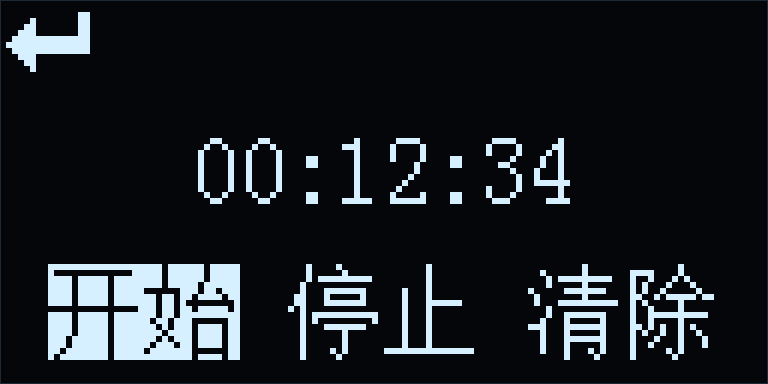 **秒表** 开始 / 停止 / 清除 |  **手电筒** OFF / ON |
| 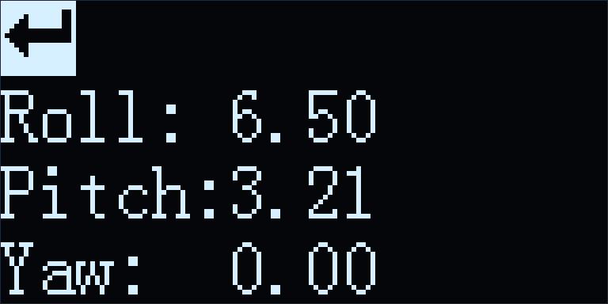 **MPU6050 姿态** Roll / Pitch / Yaw |  **水平仪菜单** 水平 / 竖直 / 斜坡 | 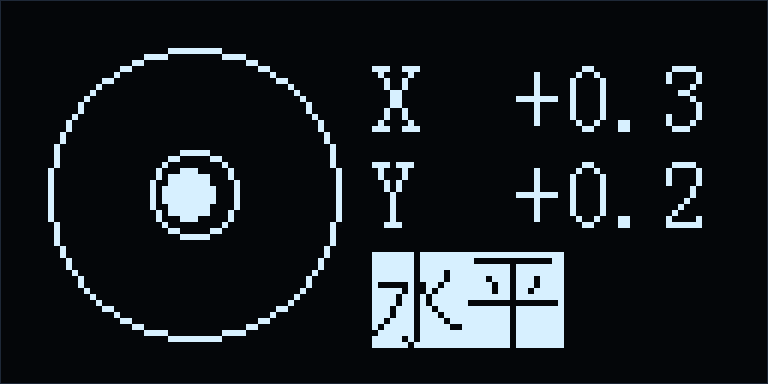 **水平仪** 气泡居中即水平 | 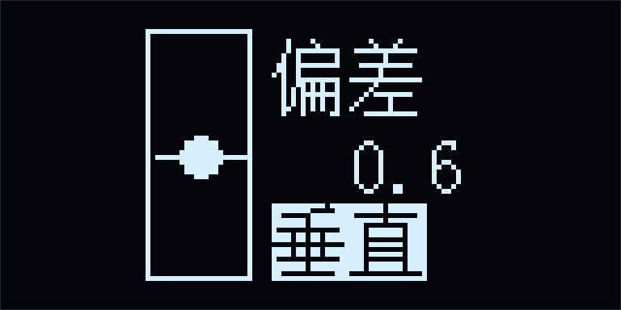 **竖直仪** 气泡居中即竖直 |
| 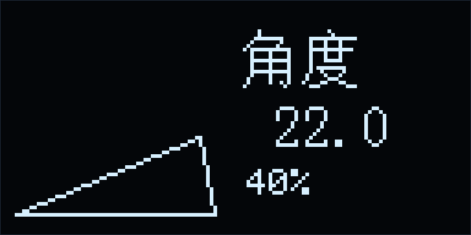 **斜坡仪** 角度 + 坡度百分比 |  **动态表情** 眨眼动画 | 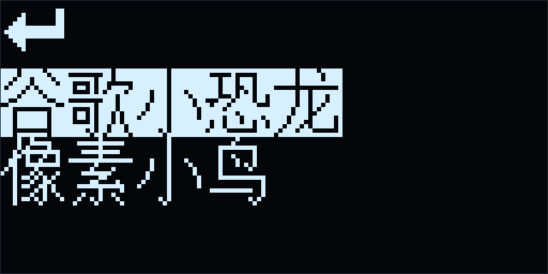 **小游戏** 小恐龙 / 像素小鸟 | 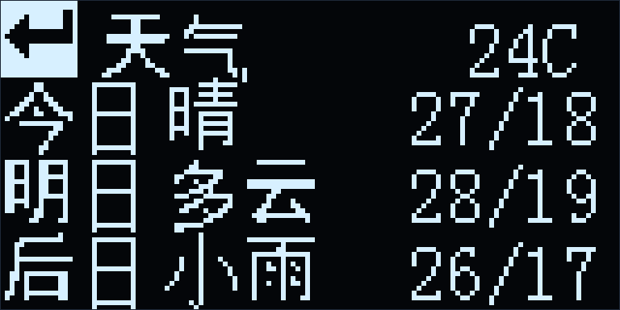 **天气·列表** 三天预报（C3 数据） |
| 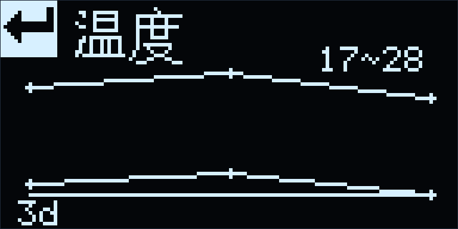 **温度趋势** 多天高/低温曲线（按键翻页） | 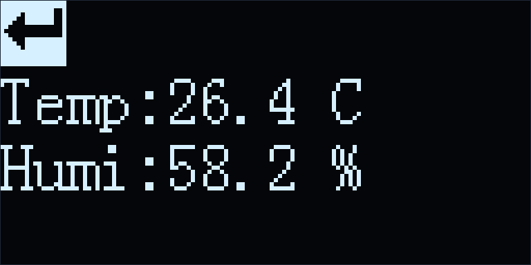 **温湿度** AHT20 |  **设置** 进入日期时间设置 | 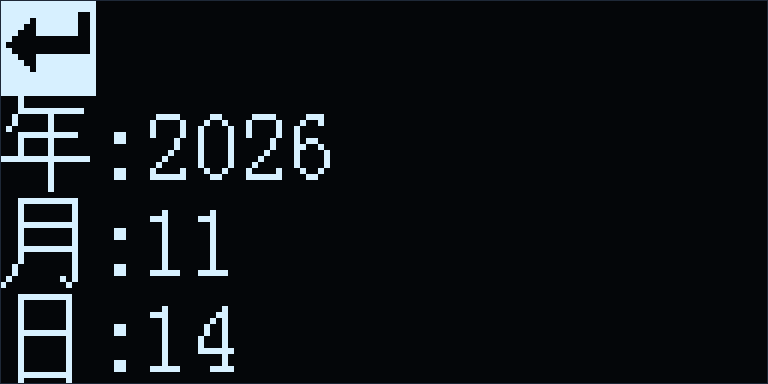 **设置日期** 年 / 月 / 日 |
| 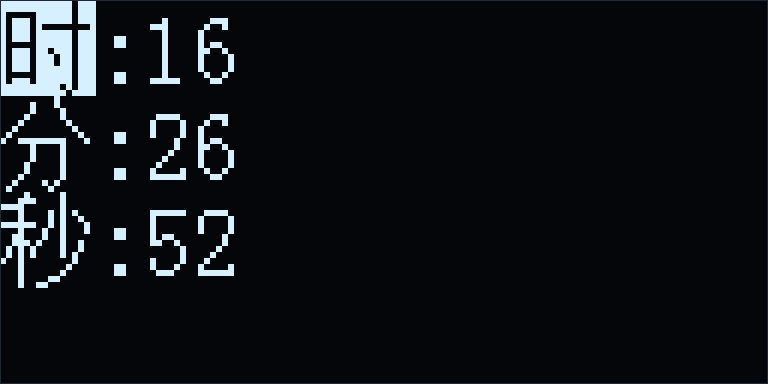 **设置时间** 时 / 分 / 秒 | | | |
