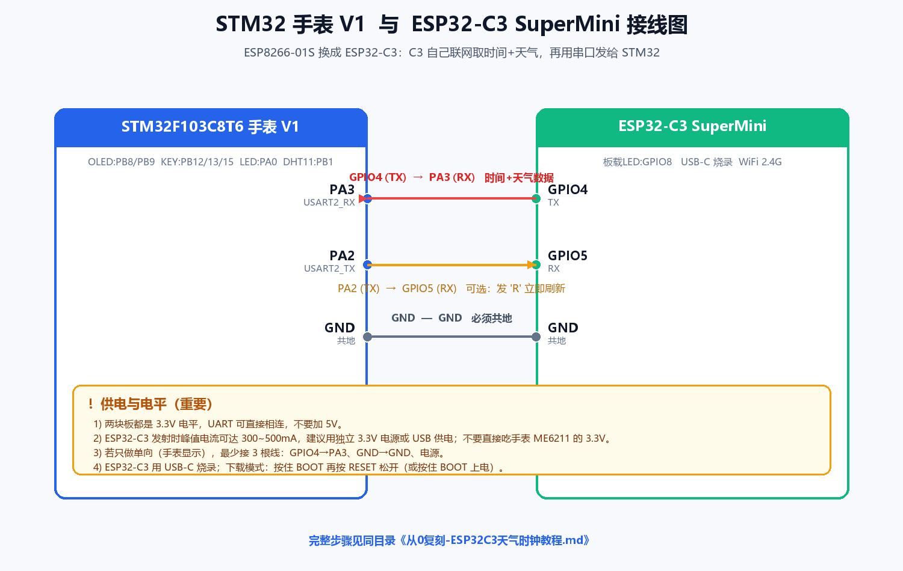

# 从 0 复刻：用 ESP32-C3 给 STM32 手表 V1 加「真实时间 + 天气」

> 目标：把开源手表 V1 里原本用 **ESP8266-01S（AT 指令）** 联网获取时间/天气的方案，改成用你手上唯一的 **ESP32-C3 SuperMini** 来实现。
> 读完照着做，你会在 OLED 首页看到：日期、星期、真实时间、天气、温度，并且断电重启后时间会自动校准。
>
> **重要（关于工程目录）**：为了不破坏你没备份的原始 `watch_v1`，所有改动都放在**复制出来的 `watch_v2/`** 里；`watch_v1/` 保持原样不动。下面说的“手表工程”都指 `watch_v2/`。

---

## 0. 先搞懂：ESP8266-01S 和 ESP32-C3 完全不是一类东西

这是新手最容易踩的坑。

| | ESP8266-01S（开源方案用的） | ESP32-C3 SuperMini（你手上的） |
|---|---|---|
| 本质 | **透传/AT 模块**，出厂固件只会听 AT 指令 | **可编程单片机**（RISC-V，160MHz），要自己写程序 |
| STM32 怎么用它 | STM32 通过串口发 `AT+CWJAP=...`、`AT+CIPSTART=...`，把整段 HTTP 报文塞给它 | STM32 只负责**收结果**；联网、发 HTTP、解析 JSON 全在 C3 里做 |
| 你要写的代码 | STM32 端一堆 AT 指令时序 + 字符串截取 | C3 端一份 Arduino 程序 + STM32 端一个简单的串口解析 |

所以**不能**把开源工程的 `esp8266.c` 直接拿来发 AT 指令给 ESP32-C3——C3 出厂没有 AT 固件（就算刷 AT 固件也麻烦、不推荐）。
正确的复刻思路是：

```
原来的： STM32 --AT指令--> ESP8266-01S --WiFi--> 互联网
新方案： STM32 <--串口一行数据-- ESP32-C3 --WiFi--> 互联网（C3 自己取时间、取天气、解析好）
```

**分工**
- **ESP32-C3**：连 WiFi → 用 NTP 取时间 → 请求心知天气 → 把 `UTC秒, 天气代码, 温度` 拼成一行，从串口发给 STM32。
- **STM32 手表**：收到这一行 → 写进 RTC（实时时钟）→ 在 OLED 上显示日期/时间/天气/温度。

这样做的好处：STM32 端的代码非常简单、稳定；以后换天气 API、加功能，只改 C3 就行，不用动手表固件。

---

## 1. 最终效果 / 数据流

```
        ┌───────────────┐   WiFi    ┌──────────────┐
        │  ESP32-C3     │──────────▶│ 路由器/互联网 │
        │ (Arduino程序) │           └──────────────┘
        │  取时间+天气  │              NTP / 心知天气
        └──────┬────────┘
               │ UART 115200，一行：
               │ $OK,1763000000,31,17
               ▼
        ┌───────────────┐
        │ STM32F103C8T6 │  → 写 RTC → OLED 显示
        │   手表 V1     │
        └───────────────┘
```

OLED 首页布局（我们改完后）：

```
┌────────────────────────┐
│ 2026-11-13 THU         │  ← 日期 + 星期
│   15:05:04             │  ← 12x24 大字时间
│ 晴                17C  │  ← 天气 + 温度
│ 菜单            设置    │  ← 原有的 菜单/设置 导航（反色高亮不变）
└────────────────────────┘
```

---

## 2. 物料清单

| 序号 | 物品 | 说明 |
|---|---|---|
| 1 | STM32 手表 V1（已焊好/能烧录） | 工程目录 `watch_v2/` |
| 2 | ESP32-C3 SuperMini | 你手上的板子，USB-C 线可烧录 |
| 3 | ST-Link（或 DAP-Link） | 烧 STM32 用 |
| 4 | 杜邦线 3~4 根 | 连 UART |
| 5 | 独立 3.3V 电源 或 USB 充电宝 | 给 C3 供电（重要，见第 3 节） |
| 6 | 2.4G WiFi | **ESP32-C3 只支持 2.4G，不支持 5G** |

---

## 3. 接线（先看这张图）



### 接线表

| ESP32-C3 SuperMini | 方向 | STM32 手表 | 作用 |
|---|---|---|---|
| **GPIO4 (TX)** | → | **PA3 (USART2_RX)** | C3 把时间/天气发给 STM32 |
| **GPIO5 (RX)** | ← | **PA2 (USART2_TX)** | 可选：STM32 发 `R` 让 C3 立即刷新 |
| **GND** | — | **GND** | **必须共地**，否则串口乱码 |
| 5V / 3V3 | — | — | 给 C3 供电（建议独立电源） |

> 只想让手表能显示：最少接 **3 根**——`GPIO4→PA3`、`GND→GND`、电源。

### 三个必须注意的点

1. **电平**：两块板都是 3.3V，UART 直连即可，**不要接 5V 到信号线**。
2. **供电**：ESP32-C3 开 WiFi 发射时峰值电流能到 300~500mA。手表上的 `ME6211C33` 稳压芯片带不动，会死机/复位。**用独立 3.3V 或 USB 给 C3 供电**，只把 GND 和 PA3/PA2 与手表相连。
3. **为什么用 PA2/PA3**：手表里 `OLED` 占了 PB8/PB9，`MPU6050` 占了 PB10/PB11，`按键`占 PB12/PB13/PB15，`DHT11`占 PB1，`LED`占 PA0。**PA2/PA3 正好空着，且是 USART2 的默认引脚**，所以选它。

---

## 4. 第一步：装好 ESP32-C3 的 Arduino 环境

（对应资料：`ESP32C3SuperMini/ESP32C3SuperMini 入门.pdf`、`ESP32C3SuperMini WiFi使用.pdf`）

1. 下载安装 **Arduino IDE 2.x**。
2. 打开 `文件(File) → 首选项(Preferences)`，在 **“附加开发板管理器网址”** 填：
   ```
   https://raw.githubusercontent.com/espressif/arduino-esp32/gh-pages/package_esp32_index.json
   ```
   （国内下载慢可换成 `https://www.arduino.cn/package_esp32_index.json` 之类的镜像）
3. `工具 → 开发板 → 开发板管理器`，搜索 **esp32**，安装最新版（Espressif Systems）。
4. `工具 → 开发板` 选 **ESP32C3 Dev Module**。
5. `工具 → 端口` 选 C3 对应的 COM 口（插上 USB-C 才会出现）。
6. 关键设置（**Q4 串口打印不出来时就是这里**）：
   - **USB CDC On Boot = Enabled** ← 这样 `Serial.print` 才能从 USB 看到
   - Flash Size = 4MB
   - 其它默认即可

> 如果电脑不认 COM 口、显示 “JTAG/serial debug unit”：把 **USB CDC On Boot** 设为 **Enabled**，再重新插拔。

---

## 5. 第二步：烧录 ESP32-C3 程序

打开本目录下的：
```
ESP32C3_WeatherClock/ESP32C3_WeatherClock.ino
```

### 只改「配置区」4 个值

```cpp
static const char* WIFI_SSID     = "YOUR_WIFI_SSID";      // 你的 WiFi 名称（2.4G）
static const char* WIFI_PASSWORD = "YOUR_WIFI_PASSWORD";  // 你的 WiFi 密码
static const char* CITY           = "xinxiang";          // 城市拼音（小写）
static const char* SENIVERSE_KEY = "YOUR_SENIVERSE_KEY";  // 心知天气私钥（自己申请，见附录 A）
```

- `CITY`：心知天气要求的**拼音小写**，例如 `beijing`、`shanghai`、`xinxiang`、`haerbin`。
- `SENIVERSE_KEY`：这是资料里自带的体验 key，**随时可能失效/限流**。请自己免费申请一个（见附录 A）。

### 烧录

1. 用 USB-C 连电脑。
2. 点 **上传(→)**。
3. 若提示连接失败：**按住 BOOT 键 → 按一下 RESET → 松开 RESET → 再松开 BOOT**，进入下载模式后重新上传。
4. 上传成功后**按一下 RESET**，程序才开始跑。

### 先单独验证 C3（不要接 STM32）

打开 `工具 → 串口监视器`，波特率 **115200**。正常会看到：

```
==== ESP32-C3 天气时钟数据源 启动 ====
正在连接 WiFi: YOUR_WIFI_SSID .....
WiFi 已连接，IP = 192.168.x.x
发送 -> utc=1763000000  code=31  temp=17
```

只要能看到 `发送 -> utc=... code=... temp=...`，说明 **C3 这一半已经成功**。
（`code=31` 是“霾”，`temp=17` 是 17℃，和你当地实时天气一致就对了。）

> 若时间获取失败会打印“时间获取失败”；若只有天气失败会显示 `(天气本次失败)`，此时 `code=-1`，STM32 会保留上次天气但时间照样校准。

---

## 6. 第三步：给 STM32 手表加「串口收数据 + 显示」

手表工程是 `watch_v2/`，用 **VS Code + EIDE 插件**（也可以用 Keil）。本目录 `stm32_patch/` 里已经放好了改好的文件，覆盖进去即可。

### 6.1 新增 4 个文件（放进 `watch_v2/Hardware/`）

| 文件 | 作用 |
|---|---|
| `Serial.c` / `Serial.h` | USART2 收发驱动（115200，中断收一行，收到 `\n` 置完成标志） |
| `esp32c3.c` / `esp32c3.h` | 解析 C3 发来的 `$OK,...`，写 RTC；天气代码→中文 |

> `watch_v2` 原本没有串口驱动，所以必须先补这两个。

### 6.2 修改 `User/main.c`

（1）加头文件：
```c
#include "esp32c3.h"
```
（2）在 `main()` 里 `Timer_Init();` 后面加一行：
```c
	ESP32C3_Init(); //初始化与 ESP32-C3 的串口（USART2），并请求一次数据
```

### 6.3 修改 `Hardware/menu.c` 的首页时钟

（1）加头文件：
```c
#include "esp32c3.h"
```
（2）把原来的 `Show_ui_Clock()` 换成下面这版（本目录 `stm32_patch/menu.c` 里已是最终版）：

```c
/* 由年月日算星期（0=周日），Sakamoto 公式 */
static const char* Week_ASCII(int y, int m, int d)
{
    static const char* names[7] = {"SUN","MON","TUE","WED","THU","FRI","SAT"};
    static const int t[] = {0,3,2,5,0,3,5,1,4,6,2,4};
    if (m < 3) y -= 1;
    int w = (y + y/4 - y/100 + y/400 + t[m-1] + d) % 7;
    if (w < 0) w += 7;
    return names[w];
}

void Show_ui_Clock(void)
{
    ESP32C3_Poll();      /* 处理 C3 发来的时间/天气（收到就写 RTC） */
    MyRTC_ReadTime();

    /* 第 1 行：日期 + 星期 */
    OLED_Printf(0, 0, OLED_6X8, "%04d-%02d-%02d %s",
                MyRTC_Time[0], MyRTC_Time[1], MyRTC_Time[2],
                Week_ASCII(MyRTC_Time[0], MyRTC_Time[1], MyRTC_Time[2]));

    /* 第 2 行：时间（12x24 大字） */
    OLED_Printf(10, 8, OLED_12X24, "%02d:%02d:%02d",
                MyRTC_Time[3], MyRTC_Time[4], MyRTC_Time[5]);

    /* 第 3 行：天气 + 温度 */
    OLED_ClearArea(0, 32, 128, 16);
    if (ESP32C3_DataValid())
    {
        OLED_ShowString(0, 32, ESP32C3_WeatherText(), OLED_8X16);
        OLED_Printf(56, 32, OLED_8X16, "%dC", ESP32C3_Temperature());
    }
    else
    {
        OLED_ShowString(0, 32, "天气 --", OLED_8X16);
    }

    /* 第 4 行：菜单 / 设置（原有导航不变） */
    OLED_ShowString(0, 48, "菜单", OLED_8X16);
    OLED_ShowString(96, 48, "设置", OLED_8X16);
}
```

> 原来的 `First_Page_Clock()` 里对 `OLED_ReverseArea(0,48,32,16)` 和 `(96,48,32,16)` 的反色高亮**不用改**，正好盖在“菜单/设置”上。

### 6.4 把新文件加进工程（EIDE）

- 用 VS Code 打开 `watch_v2/`，EIDE 插件 → 工程资源 → `Hardware` 分组右键 **添加已有文件**，把 `Serial.c`、`esp32c3.c` 加进去（`.h` 通常会自动识别，也一起加更保险）。
- 我们已同时改好 `watch_v2/.eide/eide.yml`，把 4 个文件登记进去了；若你用 Keil 的 `Project.uvprojx`，则在 Keil 里 `Add Existing Files to Group 'Hardware'` 同样添加。

### 6.5 编译下载

- 编译（Build），确认 0 error。
- ST-Link 烧录到手表。
- 上电后：先显示默认时间，几秒内 C3 发来数据，**时间自动跳到当前时间，右侧出现天气和温度**。

---

## 7. 通信协议（STM32 ↔ C3）

C3 每次取完数据，发**一行**（`\r\n` 结尾），STM32 中断里收满一行就解析：

| 报文 | 含义 |
|---|---|
| `$OK,<utc秒>,<天气代码>,<温度>\r\n` | 成功。例 `$OK,1763000000,31,17` |
| `$ERR,0,0,0\r\n` | 时间都没取到（WiFi/接口失败），STM32 保留上次显示、本地 RTC 继续走 |

- `utc秒`：UTC 的 Unix 时间戳（秒）。STM32 把它直接写进 RTC 计数；显示时 `MyRTC_ReadTime()` 会 `+8 小时`，所以显示的是北京时间。
- `天气代码`：心知天气 code（0~38），对应中文见 `esp32c3.c` 里的 `CodeToText()`；**`-1` 表示本次天气没取到**（时间仍会更新，STM32 保留上次天气）。
- `温度`：整数摄氏度。

> 想换协议（比如加湿度 `$OK,utc,code,temp,humi`）时：改 C3 的 `sendLine()` 和 STM32 的 `sscanf` 格式即可。

---

## 8. 联调 & 常见问题

| 现象 | 原因 / 解决 |
|---|---|
| C3 串口监视器无任何输出 | `USB CDC On Boot` 没设 Enabled；或没按 RESET；换一根**能传数据**的 USB-C 线 |
| Arduino 上传失败 / 找不到端口 | 按住 BOOT→按 RESET→松 RESET→松 BOOT 进下载模式；装 CH340/CP210x 驱动 |
| `WiFi 连接失败` | 只支持 **2.4G**；SSID/密码错了；路由器开了 MAC 过滤 |
| 打印“时间获取失败” | WiFi 通了但 NTP/时间接口不通 → 换网络；本项目已内置拼多多时间接口做备用 |
| 打印 `(天气本次失败)` | 天气接口 key 失效/超额或城市拼音错 → 换自己的 key（附录 A）/ 改 `CITY` |
| 时间对、天气不对/不显示 | 传的是别的城市；或 `$ERR` 后保留了上次；换 `CITY` |
| OLED 上天气是乱码 | `硬件/OLED_Data.h` 里 `OLED_CHARSET_UTF8` 与源文件编码不一致。本工程源文件是 **UTF-8**，保持 UTF-8 保存即可 |
| 串口收到一堆乱码 | **没共地**；或波特率不是 115200；或接错到 PA9/PA10 |
| 手表一接 C3 就复位/花屏 | C3 电流太大拖垮手表电源 → 给 C3 **独立供电**，只共地 |
| 时间每次都被“调回去” | 正常：C3 每 10 分钟会用网络时间重新校准一次 RTC |
| 重启后时间不对 | C3 没连上就发 `$ERR`；检查 WiFi；或 RTC 备份电池/LSE 晶振问题 |

**快速定位顺序**：先单独用 USB 看 C3 串口有没有 `发送 -> utc=...` → 再接 STM32，用逻辑分析仪/另一路 USB-TTL 看 PA3 上有没有 `$OK,...` → 最后看 OLED。

---

## 9. 进阶与优化

- **刷新频率**：C3 里 `UPDATE_INTERVAL_MS` 默认 10 分钟。心知免费额度有限，别设太短（10 分钟≈144 次/天）。
- **省电**：手表长时间不用可让 C3 进 `light sleep`，或定时唤醒取一次；STM32 端 RTC 自己走时，不依赖 C3 常连。
- **上电即刷**：STM32 的 `ESP32C3_Init()` 会发 `"R\r\n"`，C3 收到 `'R'` 立刻重发一次，避免“开机要等 10 分钟”。
- **断网表现**：C3 断网时会发 `$ERR`，STM32 保持上一次天气，时间继续由本地 RTC 走。
- **外壳/装配**：V1 手表只有 39.5×45.5mm，C3（22.5×18mm）塞不进原壳。建议第一版先**面包板/杜邦线外挂**调试通，再考虑：① 把 C3 贴背面并飞线；② 换更小的 C3 模组（ESP32-C3-MINI-1，资料在 `ESP32C3SuperMini/ESP32-C3/`）；③ 外置小电池给 C3。

---

## 附录 A：自己申请心知天气 key（免费）

1. 打开 [https://www.seniverse.com/](https://www.seniverse.com/) 注册。
2. 控制台 → 创建项目/应用 → 拿到 **私钥（API Key）**。
3. 免费版只开放“实况天气/3天预报”等基础接口，够本项目用。
4. 免费额度按天计算，10 分钟一刷很安全。

> 接口（本项目用的）：
> `http://api.seniverse.com/v3/weather/now.json?key=你的KEY&location=城市拼音&language=en&unit=c`
> 返回里 `now.code` 是天气代码，`now.temperature` 是温度。

## 附录 B：ESP32-C3 引脚说明（来自官方资料）

- 板载蓝色 LED：**GPIO8**
- 数字 IO：GPIO0~GPIO10（共 11 个），另有 UART0 的 GPIO20/21
- 本方案用 **GPIO4=TX、GPIO5=RX**（走 UART1），不占用 USB。
- 注意 strapping 脚（GPIO2/8/9）上电瞬间有特殊用途，**别拿来接关键信号**；GPIO8 是 LED、GPIO9 是 BOOT 键。

## 附录 C：如果以后想用 ESP-IDF（可选）

Arduino 足够本项目。若要用 ESP-IDF：
- 用 `esp_wifi` 连网、`esp_sntp` 取时间、`esp_http_client` 取天气；
- 串口用 `uart_driver_install` + `uart_set_pin` 把 UART1 映射到 GPIO4/5；
- 其余协议、STM32 端**完全不用改**（还是那一行文本）。

## 附录 D：交付文件清单

```
C3天气时钟复刻/
├─ 从0复刻-ESP32C3天气时钟教程.md      ← 本文件
├─ 接线图_ESP32C3_STM32.png            ← 接线示意图
├─ ESP32C3_WeatherClock/
│   └─ ESP32C3_WeatherClock.ino        ← 烧到 ESP32-C3
└─ stm32_patch/                        ← 覆盖到 watch_v2 对应位置
    ├─ Serial.c / Serial.h             → watch_v2/Hardware/
    ├─ esp32c3.c / esp32c3.h           → watch_v2/Hardware/
    ├─ main.c                          → watch_v2/User/   （已含改动）
    └─ menu.c                          → watch_v2/Hardware/（已含改动）
```

> 注：`watch_v2` 工程里的这几个文件我已直接改好（`User/main.c`、`Hardware/menu.c`、新增 4 个文件、`.eide/eide.yml` 已登记）。原始 `watch_v1` 未被改动。

---

## 附录 E：为什么 GPIO4 / GPIO5 不是“串口脚”也能当 TX/RX？

看引脚图你会发现，图上只把 **GPIO20 标成 RX、GPIO21 标成 TX**（那是 UART0 的“默认”引脚），GPIO4/5 只写了“数字脚”。但 ESP32-C3 内部有一个 **GPIO 交换矩阵（GPIO Matrix / IO_MUX）**：

- 芯片里 UART、SPI、I2C、PWM 这些“外设信号”和“物理引脚”之间不是焊死的，而是经过一个可编程的交叉开关。
- 所以任意一个**普通 GPIO** 都可以被软件路由成某个外设的 TX/RX/SCL/SDA……只要这个脚没被别的东西占用、不是特殊脚。
- 在 Arduino 里就是这一句：
  ```cpp
  Serial1.begin(115200, SERIAL_8N1, /*rx=*/5, /*tx=*/4);   // 把 UART1 的 RX/TX 映射到 GPIO5/GPIO4
  ```
  底层调用 `uart_set_pin()`，就是去配置这个矩阵。

**哪些脚“能随便用”、哪些不能：**

| 类型 | 引脚 | 说明 |
|---|---|---|
| 可自由当 UART 用 | GPIO0~GPIO7、GPIO10 | 普通 IO，都能经矩阵映射（本项目用 GPIO4=TX、GPIO5=RX） |
| 慎用（strapping 脚） | GPIO2、GPIO8、GPIO9 | 上电瞬间决定启动模式。GPIO8=板载LED、GPIO9=BOOT 键，别接关键信号 |
| 已被占用 | GPIO18/19 | 板载原生 USB（D-/D+），不引到排针 |
| 内部给 Flash | GPIO11~GPIO17 | 接板载 Flash，排针上也没有 |
| UART0 默认脚 | GPIO20(RX)/GPIO21(TX) | 想用“传统串口脚”也可以用它们，但本项目用 4/5 更灵活 |

一句话：**“引脚图没标串口”不代表不能当串口，ESP32 系列几乎所有 IO 都能重映射**；只有 strapping 脚、USB 脚、Flash 脚要避开。你的板子上 GPIO4/5 都是干净的数字脚，所以拿来做 UART1 完全没问题。

---

## 附录 F：实测踩坑记录（2026-11-13，重要！）

本次复刻中 ESP32-C3 **能扫描到 WiFi、MAC 正常、信号很强，却一直 `reason=2 AUTH_EXPIRE` 连不上**，最后用下面这组配置解决，记下来供参考：

| 措施 | 说明 |
|---|---|
| **esp32 核心降到 2.0.17** | 新版核心在 C3 上有"能扫不能认证"的兼容问题，降版本后解决 |
| **`WiFi.setTxPower(WIFI_POWER_8_5dBm)`** | 降低发射功率，避免近距离认证帧失真；已写进 `ESP32C3_WeatherClock.ino` 的 `wifiConnect()` |
| **`WiFi.setSleep(false)`** | 关闭省电，连接更稳 |
| 手机热点保持开启 | 关掉"无设备自动关闭"，手机别锁屏休眠；热点关了会报 `reason=200/201` |

成功日志长这样：
```
WiFi 已连接，IP = 10.75.138.97
发送 -> utc=1794559848  code=13  temp=23
```

**排查口诀**：`reason=2 AUTH_EXPIRE`(认证阶段超时，与密码无关) → 先降核心+降功率；
`reason=210` → 安全方式不匹配（开放网络却传了密码，或 WPA3）；
`reason=200/201` → AP 消失/不在范围（热点被关、拿远）；`reason=15` → 才是密码错。

### 附：首帧丢失 / "STM32 显示 No data 但 C3 已发出"
现象：C3 串口明明打印了 `发送 -> ...`，但手表天气页显示 `No data`，按一下 C3 的 RESET 立刻就有了。
原因：**C3 先上电发了一次数据，STM32 后上电，错过了那一帧**；之后 C3 要等 10 分钟才再发。
解决办法（任选）：
1. **接两根数据线**：STM32 `PA2(TX)` → C3 `GPIO5(RX)`。这样 STM32 每次上电会自动发 `'R'`，C3 收到立即重发（推荐，一劳永逸）。
2. 只接三根线时，STM32 上电后**按一下 C3 的 RESET**。
3. 本工程固件已内置：C3 **开机前 3 分钟每 20 秒重发一次**，之后再 10 分钟一次，基本能自动补上首帧。


